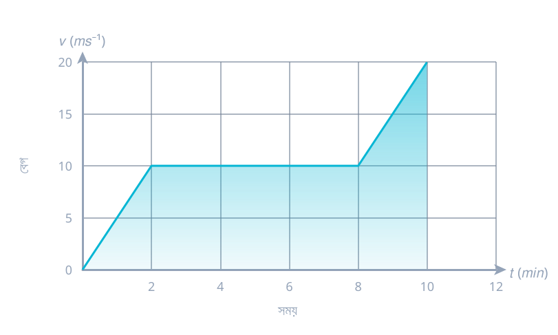

1. একটি গাড়ি স্থিরাবস্থা থেকে যাত্রা শুরু করে সমত্বরণে কিছু দূরত্ব যায়, তারপর সমমন্দনে চলে থেমে যায়। যাত্রা পথের মোট সময় $2h$ এবং পথমধ্যে সর্বোচ্চ বেগ $60kmh^{-1}$ হলে মোট অতিক্রান্ত দূরত্ব কত?
**উত্তর:** $60\ km$

2. লেখচিত্রে একটি গাড়ির যাত্রাকালীন প্রথম ১০ মিনিটে বেগের পরিবর্তন দেখানো হয়েছে।

(ক) গড় বেগের ভৌত সংজ্ঞানুযায়ী গাড়িটির গতিকালীন প্রথম চার মিনিটে গড় বেগ নির্ণয় কর।
(খ) 'গাড়িটির ১০ মিনিটে অতিক্রান্ত দূরত্ব লেখচিত্রের অন্তর্ভুক্ত ক্ষেত্রের ক্ষেত্রফলের সমান'—উক্তিটির যথার্থতা গাণিতিকভাবে বিশ্লেষণ কর।
**উত্তর:** (ক) $7.5\ ms^{-1}$

3. একটি বস্তু প্রথম $2sec$ এ $100m$ এবং পরবর্তী $4sec$ এ $104m$ দূরত্ব অতিক্রম করে। বস্তুর ত্বরণ কত? ত্বরণ অপরিবর্তিত থাকলে বস্তুটি এর পরবর্তী $4sec$ এ কত দূরত্ব অতিক্রম করবে?
**উত্তর:** $a=-8\ ms^{-2},\ s=-24\ m$ (গাড়ি পিছনের দিকে চলে আসবে)

4. একটি ট্রেন স্থিরাবস্থা হতে $10ms^{-2}$ ত্বরণে চলতে আরম্ভ করল। এই সময় একটি গাড়ি $100ms^{-1}$ বেগে ট্রেনের সমান্তরালে চলা শুরু করল। ট্রেন গাড়িটিকে কখন পিছনে ফেলবে?
**উত্তর:** $t=20\ sec$

5. একটি দেওয়ালের মধ্যে একটি গুলি $0.06\ m$ প্রবেশের পর এর বেগ $75\%$ হারায়। গুলিটি আর কত দূর প্রবেশ করবে?
**উত্তর:** $0.004\ m$

6. একটি বিমান বন্দরের রানওয়ের দৈর্ঘ্য $100m$, একটি উড়োজাহাজ উড়ার পূর্ব মুহূর্তে $216km/h$ গতিসম্পন্ন হতে হয়। উড়োজাহাজটি $15ms^{-2}$ ত্বরণে ত্বরান্বিত হলে রানওয়ে থেকে উড়তে সক্ষম হবে কি? রানওয়ের দৈর্ঘ্য সর্বনিম্ন কত হলে উড়োজাহাজটি উড়তে পারবে?
**উত্তর:** $120\ m$ (নিরাপদে উড়তে সক্ষম হবে না)

7. একটি বাস স্থিরাবস্থা থেকে $2\ ms^{-2}$ সমত্বরণে চলতে শুরু করল। দেখাও যে, $10\ ms^{-1}$ বেগে দৌড়াতে সক্ষম কোন ব্যক্তি বাস থেকে $25\ m$ এর বেশি পিছনে থাকলে বাসটি ধরতে পারবে না।
**উত্তর:** প্রদত্ত ছবিতে সমাধান অসম্পূর্ণ (প্রমাণমূলক প্রশ্ন)

8. একটি বাঘ $8m$ সম্মুখে একটি হরিণকে দেখতে পেয়ে স্থিরাবস্থা হতে $1ms^{-2}$ ত্বরণে তার পেছনে দৌড়াতে থাকে। হরিণটি টের পেয়ে $3\ ms^{-1}$ সমবেগে দৌড়াতে থাকলে কতক্ষণ পর ও কত দূরত্ব অতিক্রম করলে বাঘটি হরিণকে ধরতে পারবে?
**উত্তর:** $t=8\ sec$

9. $50m/s$ বেগে ছোড়া একটি বুলেট একখণ্ড কাঠে $25cm$ প্রবেশ করতে পারে। একই বেগসম্পন্ন বুলেট $9cm$ পুরু অনুরূপ কাঠে আঘাত করে কত বেগে বেরিয়ে যাবে?
**উত্তর:** $v=40\ ms^{-1}$

10. একটি রাইফেলের গুলি প্রতিটি $5cm$ পুরুত্বের দুইটি কাঠের তক্তাকে ভেদ করতে পারে এবং পৃথকভাবে কোনো একটি দেওয়ালের মধ্যে $20cm$ ভেদ করতে পারে। গুলিটি দেওয়ালের মধ্যে কতটুকু ভেদ করতে পারবে, যদি উল্লেখিত তক্তার একটি তক্তা দেওয়ালের সামনে সংযুক্ত করা থাকে? 
**উত্তর:** $0.1m$

11. একটি বস্তুকে খাড়া উপরে ভূপৃষ্ঠ হতে $25\ ms^{-1}$ বেগে নিক্ষেপ করা হলো। বস্তুর সর্বোচ্চ উচ্চতা, উড্ডয়নকাল ও সর্বোচ্চ উচ্চতায় উঠতে সময় কত?
**উত্তর:** সর্বোচ্চ উচ্চতা $H=31.88\ m$, উড্ডয়নকাল $T=5.10\ sec$, সর্বোচ্চ উচ্চতায় উঠতে সময় $t=2.55\ sec$

12. দুইটি ভারী বস্তু একই সঙ্গে উপর থেকে ফেলা হলো। প্রথমটি $122.5\ m$ উপর থেকে এবং দ্বিতীয়টি $200m$ উপর থেকে। প্রথম বস্তুটি যখন ভূমিতে পৌঁছে, তখন দ্বিতীয় বস্তুর উচ্চতা ও বেগ কত?
**উত্তর:** $t=5\ sec$, উচ্চতা $x=77.5m$ (ছবিতে বেগের অংশটুকু কেটে গেছে)

13. একটি পাথর একটি নির্দিষ্ট উচ্চতা হতে $5\ sec$ এ ভূমিতে পতিত হয়। পাথরটি $3\ sec$ পর থামিয়ে দিয়ে আবার পড়তে দিলে বাকি দূরত্ব অতিক্রম করে পাথরটির ভূমিতে পৌঁছাতে কত সময় লাগবে?
**উত্তর:** $t=4\ sec$

14. একটি বস্তুকে $200m$ উচ্চতা হতে ফেলে দেওয়া হলো। অপর একটি বস্তুকে $50ms^{-1}$ বেগে একই সঙ্গে খাড়া উপরে নিক্ষেপ করা হলো। বস্তুদ্বয় কখন ও কত উচ্চতায় মিলিত হবে?
**উত্তর:** $t=4\ sec$ (ছবিতে উচ্চতার অংশটুকু কেটে গেছে)

15. একজন প্যারাসুট আরোহী মুক্তভাবে বাধাহীনভাবে $50m$ নিচে পতিত হলেন। যখন প্যারাসুট খুলেছে, তখন গতি হ্রাসের হার $2ms^{-2}$ এবং তিনি $3\ ms^{-1}$ বেগে মাটিতে এসে পৌঁছেছেন। কত উচ্চতায় তিনি মুক্ত হয়েছিলেন?
**উত্তর:** $292.75\ m$

16. $44.1\ m$ গভীর একটি কূপে একটি পাথর নিক্ষেপ করা হলো। কূপের মধ্যে শব্দের বেগ $340ms^{-1}$ হলে পাথর নিক্ষেপের মুহূর্ত থেকে পানিতে পতনের শব্দ শুনতে অতিক্রান্ত সময় বের কর।
**উত্তর:** $t=3.13\ sec$

17. একজন বালক ব্রিজের উপর থেকে দাঁড়িয়ে $20\ ms^{-1}$ বেগে বল খাড়া উপরে নিক্ষেপ করল। পানির পৃষ্ঠ ব্রিজের $10\ m$ নিচে।
(i) সর্বোচ্চ উচ্চতা কত?
(ii) নিক্ষেপের কতক্ষণ পরে পানির পৃষ্ঠ স্পর্শ করবে?
(iii) $3\ sec$ পর বলটি কোথায় অবস্থান করবে?
(iv) $4.2\ sec$ পর বলটি কোথায় অবস্থান করবে?
**উত্তর:** (i) $20.408\ m$ (পানির পৃষ্ঠ থেকে $30.408m$), (ii) $t=4.53\ sec$, (iii) $h=15.9m$ (ব্রিজের উপরের দিকে), (iv) $h=-2.43\ m$ (ব্রিজের নিচের দিকে)

18. একটি গাড়ি স্থিরাবস্থা হতে সমত্বরণে $2\ sec$ এ $8m$ দূরত্ব অতিক্রম করে। এটি $5$ম সেকেন্ডে কত দূরত্ব অতিক্রম করবে?
**উত্তর:** $18\ m$

19. একটি গাড়ি $9$ম সেকেন্ডে $30\ m$ এবং $19$ম সেকেন্ডে $50\ m$ দূরত্ব অতিক্রম করে। গাড়িটির ত্বরণ ও আদিবেগ কত? প্রথম থেকে $8\ sec$ এ গাড়িটি কত দূরত্ব অতিক্রম করে?
**উত্তর:** $a=2ms^{-2},\ u=13\ ms^{-1},\ s=168\ m$

20. মুক্তভাবে পড়ন্ত একটি বস্তু পুরো পথের অর্ধেক দূরত্ব শেষ সেকেন্ডে অতিক্রম করে। একে যদি স্থিরাবস্থা হতে ছেড়ে দেওয়া হয়, তবে পতনকাল ও উচ্চতা কত?
**উত্তর:** পতনকাল $t=3.4142\ sec$, উচ্চতা $57.12\ m$